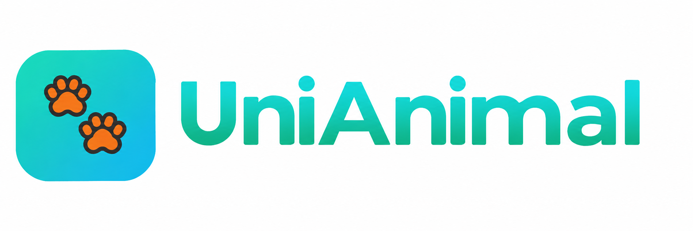

<p align="center">
  
</p>

<h1 align="center">UniAnimal</h1>

<p align="center">
  Coleira inteligente para monitoramento de animais: saúde, localização e alertas em tempo real.<br>
  <em>Trabalho de Conclusão de Curso (TCC)</em>
</p>

<p align="center">
  
  
  
  
  
</p>

---

## Sumário

- [Sobre o projeto](#sobre-o-projeto)
- [Arquitetura](#arquitetura)
- [Tecnologias](#tecnologias)
- [Funcionalidades](#funcionalidades)
- [Estrutura do repositório](#estrutura-do-repositório)
- [Instalação](#instalação)
- [Contas de demonstração](#contas-de-demonstração)
- [API](#api)
- [Testes](#testes)

---

## Sobre o projeto

A **UniAnimal** é uma solução completa de monitoramento de animais (pets e animais de produção) baseada em uma **coleira inteligente**. A coleira mede os batimentos cardíacos, a temperatura, a posição GPS e o nível de bateria, e envia esses dados para um servidor. O tutor acompanha tudo pelo **site** ou pelo **aplicativo mobile**, e recebe **alertas automáticos** quando algo foge do normal, como batimento fora da faixa, febre, bateria fraca ou o animal saindo da zona segura.

O projeto é composto por três partes que compartilham o mesmo banco de dados:

| Parte | Pasta | Descrição |
|---|---|---|
| **Site + API** | [`UltimoProjeto2.0/`](UltimoProjeto2.0/) | Aplicação Laravel: site institucional, área do cliente e API REST |
| **App mobile** | [`uni_animal_flutter/`](uni_animal_flutter/) | Aplicativo Flutter para o tutor acompanhar seus animais |
| **Firmware da coleira** | [`UltimoProjeto2.0/firmware/`](UltimoProjeto2.0/firmware/) | Código ESP32 que lê o sensor e envia a telemetria |

## Arquitetura

```
 ┌──────────────────┐   HTTP POST (JSON)   ┌──────────────────────────┐
 │  Coleira ESP32   │ ───────────────────▶ │   API Laravel (/api/v1)  │
 │  sensor MAX30102 │   chave do disposit. │                          │
 └──────────────────┘                      │  • valida e grava dados  │
                                           │  • gera alertas          │
 ┌──────────────────┐   token (API)        │  • calcula status        │
 │   App Flutter    │ ◀──────────────────▶ │                          │
 └──────────────────┘                      └────────────┬─────────────┘
                                                        │
 ┌──────────────────┐   sessão (web)                    ▼
 │   Site (Blade)   │ ◀──────────────────▶      MySQL / MariaDB
 └──────────────────┘
```

## Tecnologias

### Back-end e site
- **PHP 8.2+** e **Laravel 12**
- **Laravel Socialite** para login com Google
- **Blade** para as páginas, com CSS e JavaScript próprios
- **Chart.js** para os gráficos de batimentos na dashboard
- **Leaflet** para os mapas de localização
- **Vite** e **Tailwind CSS 4** no pipeline de assets
- **VLibras** para acessibilidade em Libras
- **MySQL 8 / MariaDB 10.4+** (XAMPP)
- **PHPUnit** para os testes automatizados

### App mobile
- **Flutter / Dart** (SDK 3.10+)
- `http` para consumir a API
- `flutter_map` + `latlong2` para o mapa
- `shared_preferences` para guardar o token de sessão
- `google_fonts` e `url_launcher`

### Hardware (IoT)
- **ESP32** com Wi-Fi
- Sensor de frequência cardíaca **MAX30102 / MAX30105** (I2C)
- Bibliotecas Arduino: *SparkFun MAX3010x* e *ArduinoJson 7*

## Funcionalidades

### Site público
- Páginas institucionais: início, sobre, diferenciais, produtos e ofertas
- **Depoimentos** de clientes, com envio de novos depoimentos
- Formulário de **contato**
- Pedido de **orçamento** com encaminhamento para o WhatsApp
- **Tema claro e escuro** e widget de acessibilidade em Libras

### Área do cliente (tutor)
- **Cadastro e login** com e-mail e senha ou com a **conta Google**
- **Dashboard** com resumo dos animais, alertas abertos e gráfico de batimentos
- **Meus Animais**: cadastro, edição e exclusão de animais, cada um vinculado ao código de uma coleira
- **Coleira**: última localização no mapa, histórico de posições, bateria e status do dispositivo
- **Perfil**: edição de nome, telefone, e-mail e endereço
- Isolamento de dados: cada tutor só acessa os próprios animais (`AnimalPolicy`)

### Monitoramento e alertas automáticos
- Recebimento de **batimento cardíaco, temperatura, GPS e bateria** enviados pela coleira
- Envio em **lote** das medições guardadas enquanto a coleira esteve sem internet
- **Faixas normais por espécie e porte** (ex.: cão pequeno, gato, cavalo, bovino)
- Alertas gerados e resolvidos automaticamente:

| Situação | Alerta |
|---|---|
| Batimento fora da faixa normal | Atenção ou emergência |
| Temperatura alta ou baixa | Atenção ou emergência |
| Bateria entre 16% e 35% / até 15% | Bateria baixa / bateria crítica |
| Animal fora das zonas seguras | Fora da zona segura |
| Coleira sem enviar dados | Coleira sem sinal |

- Status do animal atualizado automaticamente: `saudavel`, `atencao` ou `emergencia`

### App mobile
- Login pelo **código da coleira**
- Lista de animais do tutor e cadastro de novos animais
- Dashboard do animal com batimentos, métricas e status
- **Mapa** com a localização, tela de **alertas** e **histórico** de leituras

## Estrutura do repositório

```
TCC-UniAnimal/
├── UltimoProjeto2.0/            # Laravel (site + API)
│   ├── app/                     # Controllers, Models, Services, Policies
│   ├── database/
│   │   ├── migrations/
│   │   ├── seeders/
│   │   └── unianimal_v2_instalar.sql
│   ├── firmware/esp32_batimentos/
│   ├── resources/views/         # Páginas Blade
│   ├── routes/                  # web.php e api.php
│   ├── tests/
│   └── IOT_INTEGRACAO.md        # Guia de integração da coleira
├── uni_animal_flutter/          # App Flutter
├── iot.ino                      # Firmware da coleira (versão de testes)
├── apresentacao_unianimal.pdf   # Apresentação do TCC
└── unianima-logo.png
```

## Instalação

### Pré-requisitos
- [PHP 8.2+](https://www.php.net/) e [Composer](https://getcomposer.org/)
- [Node.js](https://nodejs.org/) e npm
- MySQL 8 ou MariaDB 10.4+ (o [XAMPP](https://www.apachefriends.org/) já traz os dois)
- [Flutter SDK](https://docs.flutter.dev/get-started/install) (para o app)
- [Arduino IDE](https://www.arduino.cc/en/software) com suporte a ESP32 (para a coleira)

### 1. Clonar o repositório

```bash
git clone <url-do-repositorio>
cd TCC-UniAnimal/UltimoProjeto2.0
```

### 2. Instalar as dependências

```bash
composer install
npm install
```

### 3. Configurar o ambiente

```bash
cp .env.example .env
php artisan key:generate
```

No `.env`, ajuste a conexão com o banco:

```env
DB_CONNECTION=mysql
DB_HOST=127.0.0.1
DB_PORT=3306
DB_DATABASE=unianimal_v2
DB_USERNAME=root
DB_PASSWORD=
```

Para o login com Google (opcional), preencha `GOOGLE_CLIENT_ID` e `GOOGLE_CLIENT_SECRET` com as credenciais do [Google Cloud Console](https://console.cloud.google.com/).

### 4. Criar o banco de dados

Escolha **uma** das opções:

**Opção A: importar o SQL pronto (recomendado, já vem com dados de demonstração)**

- No phpMyAdmin: aba **Importar**, sem selecionar banco, e escolha `database/unianimal_v2_instalar.sql`
- Ou pelo terminal:

```bash
C:\xampp\mysql\bin\mysql.exe -uroot < database\unianimal_v2_instalar.sql
```

**Opção B: migrations + seeders do Laravel**

```bash
php artisan migrate --seed
```

### 5. Rodar o servidor

```bash
npm run build
php artisan serve
```

Acesse **http://localhost:8000**.

Para receber dados da coleira ou do app em outro aparelho da rede, rode o servidor aberto para a rede e deixe o agendador ativo (ele detecta as coleiras sem sinal):

```bash
php artisan serve --host=0.0.0.0 --port=8000
php artisan schedule:work
```

### 6. App Flutter

```bash
cd ../uni_animal_flutter
flutter pub get
flutter run --dart-define=UNIANIMAL_API_URL=http://<ip-do-servidor>:8000
```

Endereços comuns para a API:

| Onde o app roda | URL |
|---|---|
| Emulador Android | `http://10.0.2.2:8000` |
| Emulador iOS / Web | `http://localhost:8000` |
| Celular físico | `http://<ip-do-computador>:8000` |

### 7. Coleira (ESP32)

1. Abra `UltimoProjeto2.0/firmware/esp32_batimentos/esp32_batimentos.ino` na Arduino IDE.
2. Instale as bibliotecas **SparkFun MAX3010x Pulse and Proximity Sensor Library** e **ArduinoJson** (v7).
3. Ligue o sensor MAX30102: `VIN → 3V3`, `GND → GND`, `SDA → GPIO21`, `SCL → GPIO22`.
4. Preencha no código o Wi-Fi, o IP do servidor (`API_BASE`) e a chave do dispositivo.
5. Gere a chave de uma coleira com:

```bash
php artisan coleira:chave COL-DC9FEAAA
```

Para criar coleiras novas em estoque, use `php artisan coleiras:provisionar 10`. Os detalhes do protocolo estão em [`IOT_INTEGRACAO.md`](UltimoProjeto2.0/IOT_INTEGRACAO.md).

## Contas de demonstração

Disponíveis depois de importar o SQL ou rodar os seeders:

| Onde | Login | Senha |
|---|---|---|
| Site | `rafael.nogueira@petmail.com` | `password` |
| Site | `juliana.marques@petmail.com`, `eduardo.ramos@petmail.com`, `patricia.gomes@petmail.com` | `password` |
| App | Código da coleira `COL-DC9FEAAA` (Belinha) ou `COL-42811A8F` (Bento) | — |

Coleiras livres para testar o cadastro de um animal: `COL-DEMO-0004` e `COL-DEMO-0005`.

## API

Base: `/api/v1`

| Método | Rota | Autenticação | Descrição |
|---|---|---|---|
| `POST` | `/auth/coleira` | — | Login do app pelo código da coleira |
| `POST` | `/auth/logout` | Token | Encerra a sessão do app |
| `GET` | `/me` | Token | Dados do tutor |
| `GET` / `POST` | `/animais` | Token | Lista ou cadastra animais |
| `GET` | `/animais/{id}` | Token | Detalhes do animal |
| `GET` | `/animais/{id}/batimentos` | Token | Histórico de batimentos |
| `GET` | `/animais/{id}/localizacoes` | Token | Histórico de localizações |
| `GET` | `/animais/{id}/alertas` | Token | Alertas do animal |
| `POST` | `/alertas/{id}/lido` | Token | Marca um alerta como lido |
| `GET` | `/iot/config` | Chave da coleira | Configuração da coleira (intervalo, faixas, zonas seguras) |
| `POST` | `/iot/telemetria` | Chave da coleira | Envia uma medição |
| `POST` | `/iot/telemetria/lote` | Chave da coleira | Envia até 200 medições acumuladas |

## Testes

```bash
cd UltimoProjeto2.0
php artisan test
```

Os testes cobrem o isolamento de dados entre tutores, o cadastro de contas e animais e o recebimento de telemetria da coleira.

---

<p align="center">Feito com 🐾 pela equipe UniAnimal</p>
